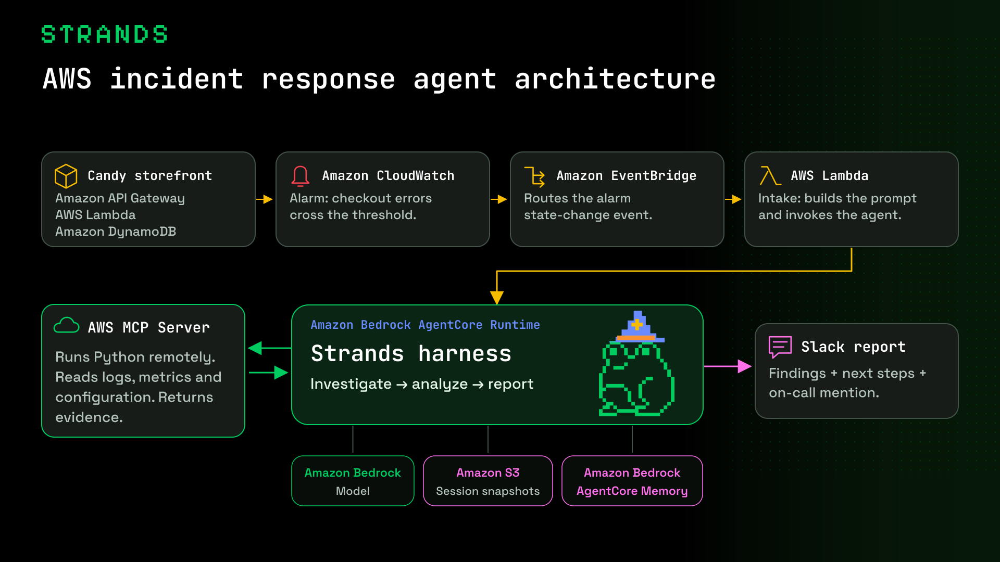
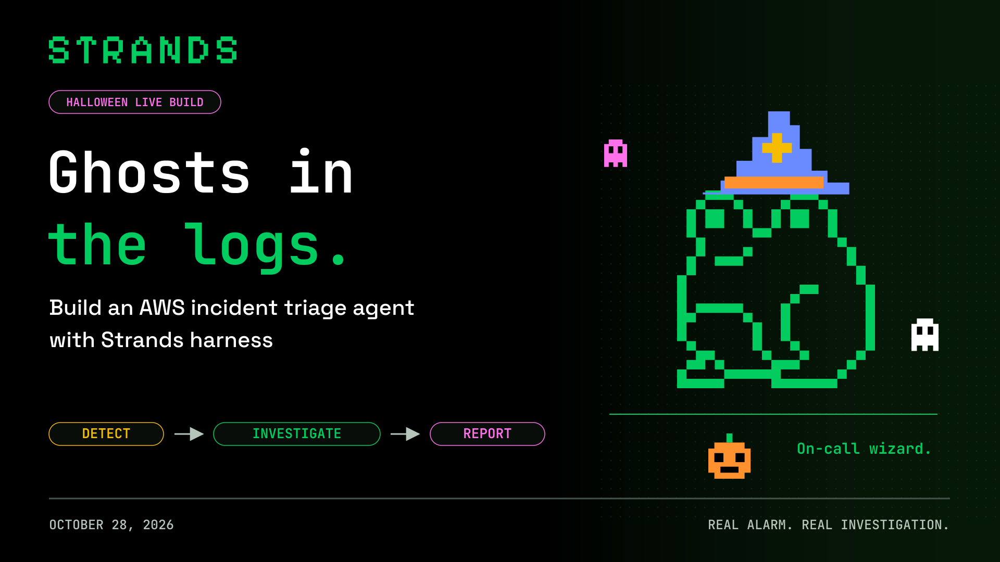
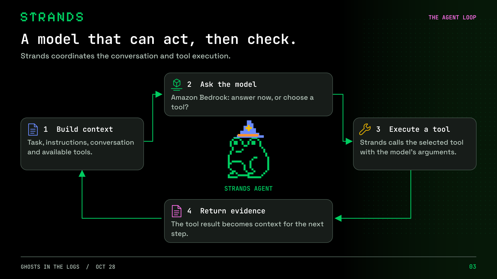
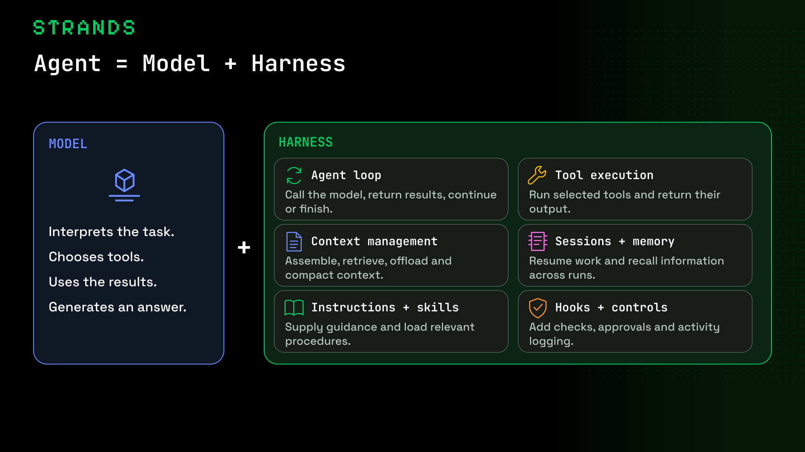
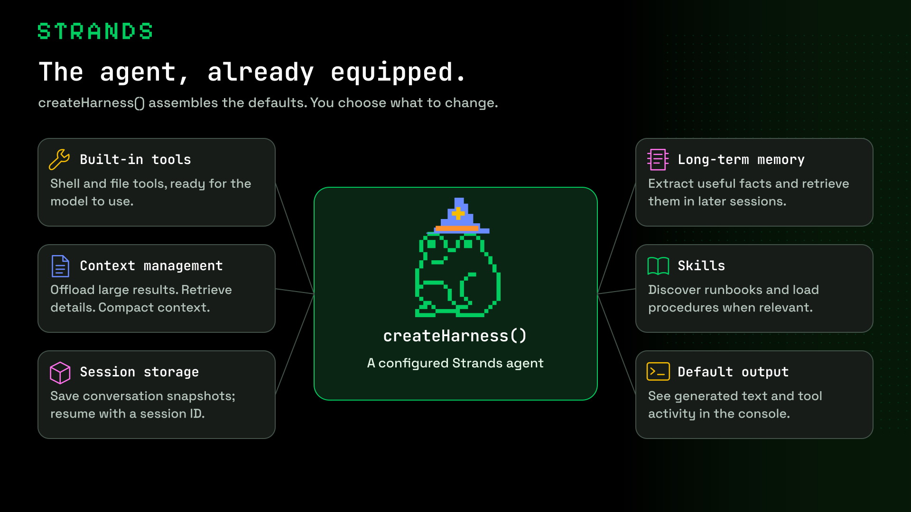
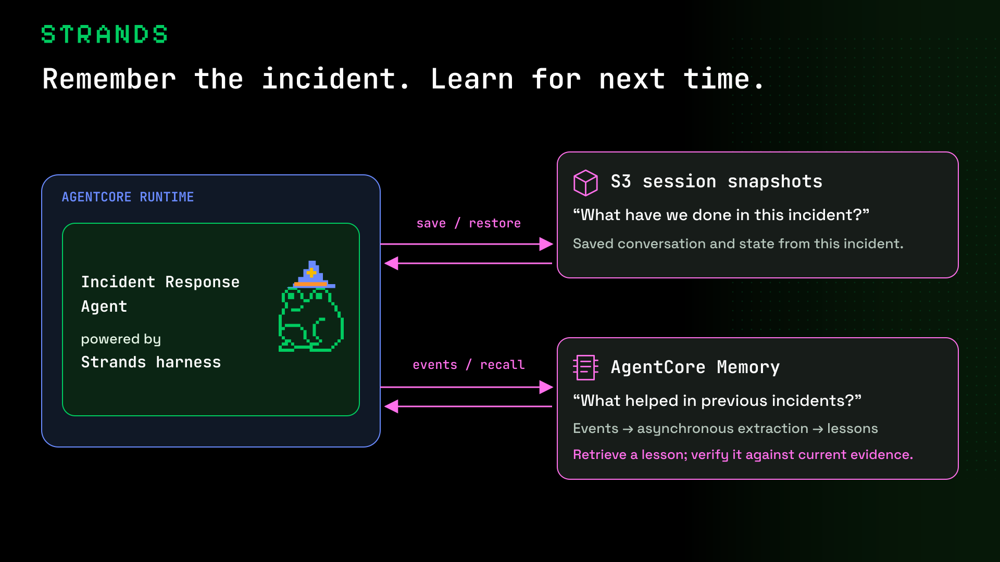
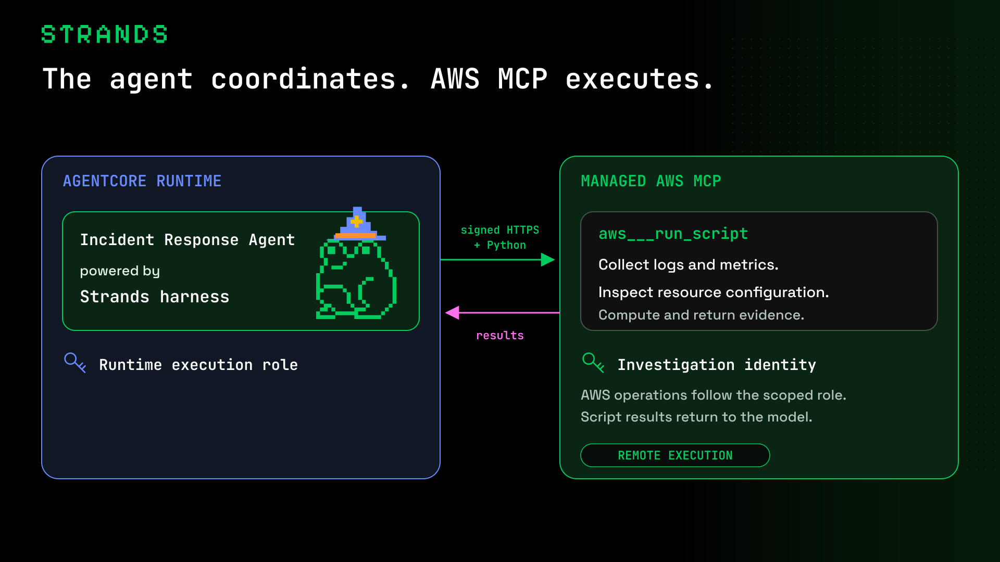
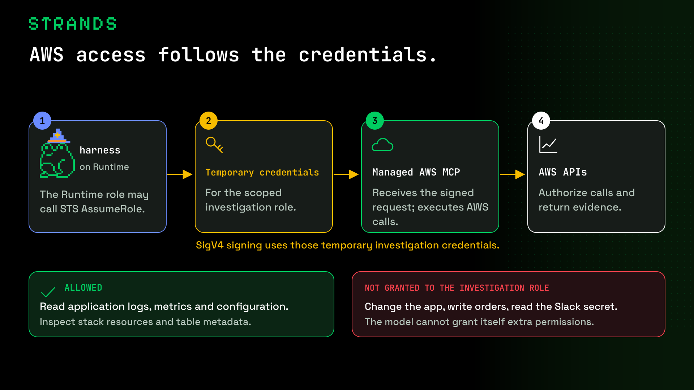
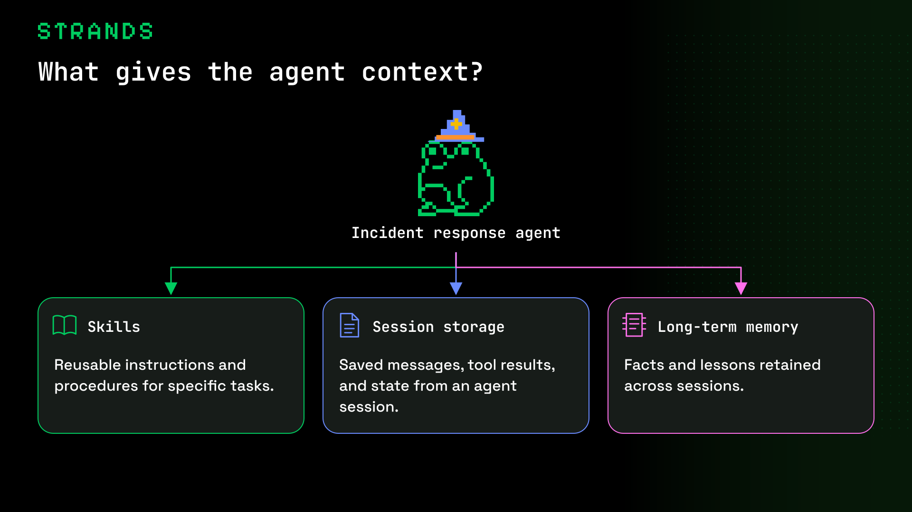

# Trick or Trace

Build an AWS incident response agent with **Strands harness**. Break a Halloween candy storefront, let Amazon CloudWatch trigger an investigation, and receive the findings in Slack.

The demo follows this path:

**Failed checkout → Amazon CloudWatch alarm → Amazon EventBridge → AWS Lambda → Amazon Bedrock AgentCore Runtime → Slack report.**

The agent uses a model on Amazon Bedrock, a packaged investigation skill, Amazon S3 session storage, Amazon Bedrock AgentCore Memory, and the remote AWS MCP Server. Generated investigation scripts execute through AWS MCP. The engineer applies the fix; the agent investigates and recommends.



[Download architecture PNG](visuals/png/02-architecture.png) · [Editable SVG](visuals/svg/02-architecture.svg)

## Before you start

Run the commands below from the repository root in a Bash-compatible terminal. Download or clone this repository first; the sample does not need the author's AWS account, Slack workspace, or deployed endpoints.

You need:

- Node.js **22 or newer**, npm, AWS CLI v2, and `zip`.
- A configured AWS CLI profile in an account where you can deploy CloudFormation stacks, IAM roles, Lambda, API Gateway, DynamoDB, S3, EventBridge, CloudWatch, SQS, Secrets Manager, and Bedrock AgentCore resources. The deployer also needs permission to pass the template's roles to the services. An agent's runtime role is not a deployment role.
- A region supporting AgentCore Runtime V2, Memory, and AWS MCP. The example commands use `us-east-1`.
- Access to a tool-capable Amazon Bedrock model or inference profile in that region. Complete any model-provider access requirements before running the agent.
- A Slack workspace where you can install an app, or an administrator who can approve it.

This creates billable AWS resources and a public, throttled demo storefront. Use a demo environment and follow [cleanup](#cleanup) when finished. Orders are fictional; there is no payment integration.

Set these non-secret values once in your terminal:

```bash
export AWS_PROFILE=default
export AWS_REGION=us-east-1
export DEMO_PREFIX=haunted
export SLACK_SECRET=haunted-oncall/slack
export MODEL_ID='bedrock/us.anthropic.claude-sonnet-5-5'

aws sts get-caller-identity
npm ci --ignore-scripts
npm run check
```

Replace `default` with your configured profile. If it uses IAM Identity Center, sign in with `aws sso login --profile "$AWS_PROFILE"` first. Check that `get-caller-identity` reports the account you intend to use. Choose an available model for `MODEL_ID`; the value above is the example model, not a guarantee of access in every account. Keep the `bedrock/` provider prefix.

Keep `DEMO_PREFIX` consistent in every command. It names the three stacks (`haunted-app`, `haunted-agents`, `haunted-monitoring` by default). Use a unique prefix if those names already belong to another deployment. No `.env` file or static credentials in source are required.

## 1. Set up Slack

1. Open [Your Slack Apps](https://api.slack.com/apps), select **Create New App → From scratch**, give it a name such as **Trick or Trace**, and select your workspace.
2. Open **OAuth & Permissions**. Under **Scopes → Bot Token Scopes**, add **`chat:write`**. This sample only posts messages; it needs no Events API subscription, incoming webhook, Socket Mode connection, or Slack request URL.
3. Select **Install to Workspace** and approve the permission, or request administrator approval. If you change scopes after installing, reinstall the app.
4. Create or choose a report channel. In Slack, invite the app with `/invite @YourAppName`, or use the channel's **Integrations → Add apps** option. Invite it even for a public channel; `chat:write.public` is not needed. For a private channel, a member must add it.
5. Collect these three values, but do not put them in a repository file:

| Secret field | Where to find it |
|---|---|
| `bot_token` | App settings → **OAuth & Permissions → Bot User OAuth Token**. Use the token beginning `xoxb-`, not an app-level or user token. |
| `channel_id` | Open the channel in Slack, click its name, and find **Channel ID** in the channel details. Alternatively, copy the channel link: the channel ID is its `C…` or `G…` segment. Do not use the channel name or the workspace's `T…` ID. |
| `oncall_user_id` | Open the engineer's Slack profile → **More / three dots → Copy member ID**. Use that ID, not their display name or email. |

The app always posts to this configured channel and mentions this configured member. There is no Slack chat or reply handler in this demo.

## 2. Save the Slack settings in AWS Secrets Manager

Use the same AWS profile and region as the deployment:

```bash
bash scripts/setup-slack.sh "$AWS_REGION" "$SLACK_SECRET"
```

The script prompts for the bot token, channel ID, and member ID. The token is hidden while you type. Paste raw IDs without `#`, `@`, or `<@…>` markup.

The script creates this JSON structure directly in Secrets Manager through standard input:

```json
{
  "bot_token": "REPLACE_WITH_YOUR_BOT_TOKEN",
  "channel_id": "REPLACE_WITH_YOUR_CHANNEL_ID",
  "oncall_user_id": "REPLACE_WITH_YOUR_MEMBER_ID"
}
```

It prints the secret ARN, creates no secret file, and does not display the token. The caller needs `secretsmanager:CreateSecret`. Use the default Secrets Manager encryption key for this walkthrough; a customer-managed KMS key requires additional decrypt permissions in the runtime role.

If the secret already exists and you intend to replace its three values:

```bash
bash scripts/setup-slack.sh "$AWS_REGION" "$SLACK_SECRET" update
```

That operation requires `secretsmanager:PutSecretValue`. The deployment script resolves the secret ARN with `DescribeSecret`; it does not fetch the token. The running application reads the value only when posting to Slack.

## 3. Enable traces and deploy

### Enable CloudWatch Transaction Search

Before your first investigation, enable [CloudWatch Transaction Search](https://docs.aws.amazon.com/AmazonCloudWatch/latest/monitoring/Enable-TransactionSearch.html) in the same account and region. In the CloudWatch console, open **Application Signals → Transaction Search**, choose **Enable**, and follow the setup prompts. AgentCore observability may also present an enablement banner.

For a short, low-volume demo, select **100% span indexing** if you want every investigation searchable. Review the console's permissions and charges before enabling it. This is an account-level setting, not a resource created or deleted by this sample's stacks. Application tracing and span indexing are separate; see [the tracing guide](docs/observability.md).

### Run the deployment script

```bash
bash scripts/deploy.sh "$AWS_PROFILE" "$AWS_REGION" \
  "$MODEL_ID" "$SLACK_SECRET" "$DEMO_PREFIX"
```

The script uses AWS CloudFormation and uploads the storefront and agent package:

| Stack | What it creates |
|---|---|
| `${DEMO_PREFIX}-app` | Candy storefront, API Gateway, checkout Lambda, DynamoDB table, logs, a disabled traffic schedule, traffic Lambda, and artifact bucket. |
| `${DEMO_PREFIX}-agents` | AgentCore Runtime V2, IAM roles, AgentCore Memory, S3 session bucket, intake Lambda, dispatch failure queue, and trace delivery. |
| `${DEMO_PREFIX}-monitoring` | Checkout error-rate alarm and the EventBridge route into the intake Lambda. The script initially creates it without the route, then connects it after the agent stack is ready. |

The agent is packaged as a ZIP with locked Linux ARM64 dependencies for the `NODE_22` managed runtime. **No Docker build, Python installation, or local MCP server is required.** `MODEL_ID` is passed through CloudFormation to the agent's environment. The prefix and generated resource identifiers are also passed through the stack; do not paste account IDs or ARNs into the source.

Allow time for first provisioning, especially AgentCore Memory. The agent stack uses disabled rollback so successful resources remain available for diagnosis if deployment fails. Check **CloudFormation → stack → Events** for the first failed resource; correct the cause, then retry or delete the failed stack before starting over. A failed update may leave an earlier runtime revision serving traffic.

When deployment succeeds, the script prints agent stack outputs and the storefront URL. Verify the runtime:

```bash
RUNTIME_ARN=$(aws cloudformation describe-stacks \
  --stack-name "$DEMO_PREFIX-agents" \
  --query 'Stacks[0].Outputs[?OutputKey==`RuntimeArn`].OutputValue | [0]' \
  --output text)
RUNTIME_ID="${RUNTIME_ARN##*/}"

aws bedrock-agentcore-control get-agent-runtime \
  --agent-runtime-id "$RUNTIME_ID" \
  --query '{status:status,platform:platformVersion,revision:agentRuntimeVersion}'

aws bedrock-agentcore-control list-agent-runtime-endpoints \
  --agent-runtime-id "$RUNTIME_ID" \
  --query 'runtimeEndpoints[*].{name:name,status:status,liveRevision:liveVersion}'
```

Expect `READY`, platform `V2`, and a ready `DEFAULT` endpoint. Compare its live revision to the runtime revision before proceeding.

## 4. Open your storefront

Retrieve the endpoint from your application stack whenever you need it:

```bash
STORE_URL=$(aws cloudformation describe-stacks \
  --stack-name "$DEMO_PREFIX-app" \
  --query 'Stacks[0].Outputs[?OutputKey==`StorefrontUrl`].OutputValue | [0]' \
  --output text)
printf 'Open this URL in your browser:\n%s\n' "$STORE_URL"
```

You can also find **StorefrontUrl** under **CloudFormation → `${DEMO_PREFIX}-app` → Outputs**. The HTML is stored in a private S3 bucket and served through API Gateway and Lambda. Use the printed API Gateway URL, not an S3 website endpoint. You do not need a local web server to use the storefront.

## 5. Run a positive test

Open the storefront, select a quantity, and place a demo order. Expect an order confirmation. To establish a clean baseline, run:

```bash
npm run demo -- --prefix "$DEMO_PREFIX" reset
npm run demo -- --prefix "$DEMO_PREFIX" start-traffic
npm run demo -- --prefix "$DEMO_PREFIX" status
```

Expected traffic output:

```json
{"requests":20,"errors":0}
```

`start-traffic` sends **one burst of 20 concurrent requests**, then stops. The generator invokes the checkout Lambda directly, so the browser order tests the frontend/API path while this burst tests checkout and generates real Lambda metrics. It also disables any old minute schedule.

Repeat `status` until the alarm is `OK` before proceeding. Successful checkout traffic does not invoke the incident agent or send a Slack message.

## 6. Inject the haunt and investigate

```bash
npm run demo -- --prefix "$DEMO_PREFIX" haunt
```

This points checkout's `TABLE_NAME` at a nonexistent table, waits for the Lambda configuration update, and **automatically sends 20 requests**. Expected traffic output:

```json
{"requests":20,"errors":20}
```

Place an order in the browser again to see the visible checkout failure. No separate traffic command is needed after `haunt`.

```bash
npm run demo -- --prefix "$DEMO_PREFIX" status
```

The alarm evaluates one 60-second period with at least five requests and more than 20% errors. Metric publication and evaluation take additional time. Wait for the transition from `OK` to `ALARM`; the state-change event starts the investigation. Repeating `haunt` while already in `ALARM` does not create a new transition.

Watch the configured Slack channel for the findings, evidence, recommended action, incident UUID, and on-call mention. The code checks Slack's `ok` response before logging successful delivery. The report is posted directly in Slack; no ticket, separate report website, automatic repair, or Slack follow-up interface is created.

## 7. Find traces and logs

Open **Amazon Bedrock AgentCore → Observability** in the same account and region. Select a time range such as **Last 30 minutes**, find the `${DEMO_PREFIX}_investigator` service, and open the latest investigation. Search for `incident-<incident UUID>` using the UUID from Slack or the runtime logs. Allow a few minutes for trace ingestion.

Look for:

- `invoke_agent haunted-investigator`: the agent input, final output, and duration. This agent name is fixed in the sample even if you change the resource prefix.
- `chat`: model calls.
- `execute_tool aws___run_script`: the generated script and AWS MCP result. Inspect the nested `api_calls` and execution status; a successful tool envelope does not guarantee every AWS API call succeeded.

The MCP server is remote and uses signed Streamable HTTP. These are the agent's tool spans, not a view into AWS MCP's internal sandbox.

For console logs, use the runtime ID discovered in step 3:

```bash
aws logs tail "/aws/bedrock-agentcore/runtimes/${RUNTIME_ID}-DEFAULT" \
  --since 15m --follow
```

The successful alarm-driven path logs `investigating`, `slack_posted`, and `completed`. `ACCEPTED` only means the asynchronous request was accepted; it does not prove completion. Press **Ctrl+C** to stop tailing logs without stopping the agent.

To find the application log group:

```bash
APP_LOG_GROUP=$(aws cloudformation describe-stacks \
  --stack-name "$DEMO_PREFIX-app" \
  --query 'Stacks[0].Outputs[?OutputKey==`LogGroup`].OutputValue | [0]' \
  --output text)
aws logs tail "$APP_LOG_GROUP" --since 15m
```

The same groups are available in **CloudWatch → Logs → Log groups**. For missing spans, trace-ID queries, and dispatch failures, see [the observability guide](docs/observability.md). Trace inputs and outputs may contain application data; keep tokens out of model prompts and screenshots.

## Recover and repeat

Wait for the investigation to finish, then restore the application:

```bash
npm run demo -- --prefix "$DEMO_PREFIX" reset
npm run demo -- --prefix "$DEMO_PREFIX" start-traffic
npm run demo -- --prefix "$DEMO_PREFIX" status
```

Verify a successful browser checkout and `{"requests":20,"errors":0}`. Wait for `OK` before another haunt. Missing data is treated as nonbreaching, so an alarm can return to `OK` while the fault is still present; a successful checkout is the recovery check.

Memory persists between incidents. For a deliberately fresh test, the optional [clear-memory command](docs/demo-commands.md#clear-memory-before-a-fresh-test) deletes the sample's stored conversations and learned records. It is not needed for normal setup.

## Troubleshooting

| Symptom | Check |
|---|---|
| Secret creation says it already exists | Use the setup script's `update` mode only if you intend to replace those values. |
| Slack reports `not_in_channel` or `channel_not_found` | Invite the bot; verify the channel ID and that the token belongs to the same workspace. |
| Slack reports `invalid_auth`, `token_revoked`, or `missing_scope` | Check the Bot User OAuth Token and `chat:write`; reinstall if scopes changed, then update the secret. |
| All traffic is healthy after `haunt` | Confirm profile, region, and prefix match your stacks; inspect the CLI output and Lambda configuration. |
| Alarm stays `OK` immediately after failures | Allow metric publication/evaluation time. Check request counts and other traffic in that minute. |
| Alarm is `ALARM` but no investigation starts | Check the monitoring EventBridge target, intake Lambda logs, and the `FailureQueueUrl` agents-stack output. |
| Agent fails with model access/validation errors | Check `MODEL_ID`, model access, and regional/inference-profile availability; redeploy after changing it. |
| Service traces appear but no model/tool detail | Enable Transaction Search, check time range/indexing, and verify the current deployment's `OTEL_TRACES_SAMPLER=always_on`. See [observability](docs/observability.md). |
| No Slack message despite `ACCEPTED` | Read runtime logs for the investigation error. Dispatch acknowledgement is not successful delivery. |

## Code and visual walkthrough

The agent is [agent.ts](agent.ts); the MCP signing helper is [support/aws.ts](support/aws.ts); the runbook is [.agent/skills/checkout-investigation/SKILL.md](.agent/skills/checkout-investigation/SKILL.md). Deployment templates are in [templates](templates), and the small default-harness example is [examples/basic](examples/basic).

Run `npm run basic` with the AWS settings above to create/read a local Halloween checklist. Its default shell/file tools run on your computer. The deployed incident agent enables only the host runbook reader and AWS MCP. Its runtime role handles Bedrock, sessions, memory, telemetry, Slack, and assuming the investigation role. The investigation role has scoped read permissions; some metrics/query-result reads require wildcard resource scope. IAM limits tool access but does not guarantee that the model ignores every malicious instruction in logs.

Each graphic is exported as an individual 1920×1080 PNG with an editable SVG. Graphic 2 is shown above; the remaining eight are below. [Browse all graphics and presenter notes](visuals/README.md).

### 1. Trick or Trace



[PNG](visuals/png/01-title.png) · [Editable SVG](visuals/svg/01-title.svg)

### 3. The Strands agent loop



[PNG](visuals/png/03-strands-loop.png) · [Editable SVG](visuals/svg/03-strands-loop.svg)

### 4. Agent = Model + Harness



[PNG](visuals/png/03b-what-is-a-harness.png) · [Editable SVG](visuals/svg/03b-what-is-a-harness.svg)

### 5. What harness gives you



[PNG](visuals/png/04-harness-defaults.png) · [Editable SVG](visuals/svg/04-harness-defaults.svg)

### 6. harness on Runtime with sessions and memory



[PNG](visuals/png/05-runtime-memory.png) · [Editable SVG](visuals/svg/05-runtime-memory.svg)

### 7. Runtime and AWS MCP execution



[PNG](visuals/png/06-runtime-interpreter.png) · [Editable SVG](visuals/svg/06-runtime-interpreter.svg)

### 8. AWS MCP and the investigation role



[PNG](visuals/png/07-mcp-iam.png) · [Editable SVG](visuals/svg/07-mcp-iam.svg)

### 9. What gives the agent context?



[PNG](visuals/png/08-skills-context-memory.png) · [Editable SVG](visuals/svg/08-skills-context-memory.svg)

## Cleanup

These steps **delete the demo and its stored data**. Wait for active investigations to finish. Use the same profile, region, and prefix as deployment. First discover the buckets while their stacks still exist:

```bash
npm run demo -- --prefix "$DEMO_PREFIX" stop-traffic

SESSION_BUCKET=$(aws cloudformation describe-stacks \
  --stack-name "$DEMO_PREFIX-agents" \
  --query 'Stacks[0].Outputs[?OutputKey==`SessionBucket`].OutputValue | [0]' \
  --output text)
ARTIFACT_BUCKET=$(aws cloudformation describe-stacks \
  --stack-name "$DEMO_PREFIX-app" \
  --query 'Stacks[0].Outputs[?OutputKey==`ArtifactBucket`].OutputValue | [0]' \
  --output text)
```

Delete the monitoring stack first so it cannot start new investigations. Empty the two demo buckets, then delete the agent and application stacks in dependency order:

```bash
aws cloudformation delete-stack --stack-name "$DEMO_PREFIX-monitoring"
aws cloudformation wait stack-delete-complete --stack-name "$DEMO_PREFIX-monitoring"

aws s3 rm "s3://$SESSION_BUCKET" --recursive
aws s3 rm "s3://$ARTIFACT_BUCKET" --recursive
aws cloudformation delete-stack --stack-name "$DEMO_PREFIX-agents"
aws cloudformation wait stack-delete-complete --stack-name "$DEMO_PREFIX-agents"
aws cloudformation delete-stack --stack-name "$DEMO_PREFIX-app"
aws cloudformation wait stack-delete-complete --stack-name "$DEMO_PREFIX-app"
```

AgentCore Memory deletion can take several minutes. If a wait command times out or deletion fails, inspect CloudFormation Events before proceeding. This sample's buckets are unversioned; if you enabled versioning separately, delete object versions and delete markers too.

The Slack secret was created separately. If no other application uses it, schedule its deletion:

```bash
aws secretsmanager delete-secret --secret-id "$SLACK_SECRET" --recovery-window-in-days 7
```

Remove the Slack app if it is no longer needed. Review service-created runtime/intake log groups and traces separately; they are not all managed by these stacks. Do not disable shared account-level Transaction Search settings just to clean up this demo.

## References and validation

- [Strands harness documentation](https://strandsagents.com/docs/user-guide/harness/)
- [Strands harness on GitHub](https://github.com/strands-agents/harness-sdk) · [TypeScript harness source](https://github.com/strands-agents/harness-sdk/tree/main/harness-ts)
- [Slack app quickstart](https://docs.slack.dev/quickstart/) and [`chat:write`](https://docs.slack.dev/reference/scopes/chat.write/)
- [CloudWatch Transaction Search setup](https://docs.aws.amazon.com/AmazonCloudWatch/latest/monitoring/Enable-TransactionSearch.html)
- [AgentCore observability setup](https://docs.aws.amazon.com/bedrock-agentcore/latest/devguide/observability-configure.html)
- [Validation record](VALIDATION.md): separates local checks, earlier hosted rehearsals, and what has not been revalidated.
