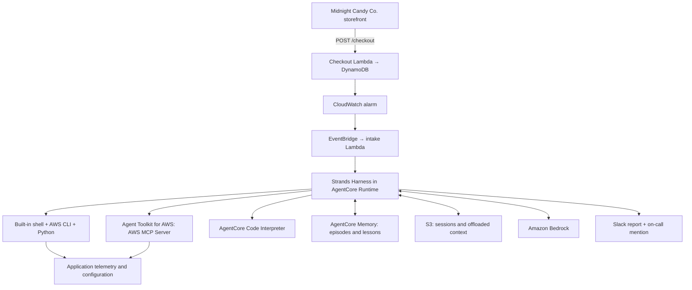

# Ghosts in the Logs: AWS Incident Triage with Strands Harness

**Candy-store checkout fails → CloudWatch alarm → Harness investigation → report in Slack.**

All agent code is in `agent.py`. It runs one Harness agent with built-in shell/file tools, Agent Toolkit for AWS, AgentCore Code Interpreter, packaged runbooks, and AgentCore Memory. It has no custom tools, role switching, ticket integration, or agent-to-agent handoff.

**Demo status:** Local checks and browser previews have passed. AWS deployment and real alarm-to-Slack delivery have not yet been verified. See [validation details](VALIDATION.md) and the [livestream run of show](docs/run-of-show.md).



## The agent file

The `create_harness()` call accepts the Harness defaults for built-in tools, skills, and context management. The default tools include shell/file operations, web fetching, subagents, and programmatic tool calling; native web search depends on the model/provider. The agent decides which AWS CLI commands, boto3 scripts, log queries, and calculations it needs.

`tools` adds two existing integrations:

- The AWS MCP Server from Agent Toolkit for AWS, connected through the official `mcp-proxy-for-aws` library using the runtime's IAM credentials. It provides AWS documentation, AWS skills, and execution tools.
- The official Strands `AgentCoreCodeInterpreter` integration for analyzing collected data.

The built-in shell executes in the Runtime environment. Code Interpreter is a separate execution environment; the agent must pass collected evidence to it rather than assuming it shares the Runtime's credentials or files.

After the agent returns its report, `post_report_to_slack(incident_id, report)` retrieves the token from Secrets Manager and posts the report with the on-call mention. It is an ordinary function called by the application, not an agent tool.

The Runtime entrypoint supports background investigation, so intake can return after acceptance. `async with create_harness(...)` closes the agent and flushes pending memory work.

## IAM is the AWS boundary

`templates/agents.yaml` separates the runtime role's permissions into two policies:

| Policy | Allowed operations |
|---|---|
| `InvestigateCheckout` | Query/read the application's logs; retrieve metrics; inspect its Lambda configuration, DynamoDB table metadata, and CloudFormation stack |
| `OperateAgent` | Invoke Bedrock; operate Code Interpreter; write runtime logs; persist sessions/memory; retrieve the one Slack secret; read the deployment archive |

The application policy grants named actions, not `ReadOnlyAccess` or administrator permissions. Resource-scoped actions target the sample application. Metric retrieval and query-result retrieval use `Resource: '*'` in this template; those API permissions have broader read scope.

There are no grants to update the sample Lambda, write orders, change IAM, or assume another role. A generated AWS command does not gain additional permissions because the agent wrote it. The AWS MCP Server forwards downstream calls under the caller's existing AWS permissions; no deprecated `aws-mcp:InvokeMcp` grants are included.

All code in the Runtime shares the runtime role, including access to its operational resources. IAM controls AWS requests, not local filesystem or shell execution.

## Skills, memory, and sessions

The bundled runbook is `.agent/skills/checkout-investigation/SKILL.md`, with a small architecture reference alongside it. The process starts in the package directory so Harness can discover `./.agent/skills` without a `skills` argument. The runbook directs generated scripts and evidence files to `/tmp`. Harness discovers the skill metadata and loads the full procedure when the agent activates the skill. Updating the bundled skill means redeploying the package.

AgentCore Memory stores episodes and reflections under `/services/{actorId}/`. The service identity remains stable across incidents, while each alarm gets a new incident/session ID. Harness injects relevant memories and provides `search_memory` for deliberate recall.

The runbook requires current evidence before reusing a previous fix. An engineer's confirmed resolution can be added to the original session so future incidents can learn from it. Server-side episode extraction is asynchronous; flushing events does not mean extraction has finished.

S3 snapshots preserve the current incident conversation and offloaded context. They are separate from cross-incident memory.

## Setup

Use Python 3.12, `uv`, and AWS CLI credentials for the chosen demo account. The example Region is `us-west-2`, where the AWS MCP endpoint is documented. Select a Bedrock model/inference profile available to your account.

Prepare a Slack app with `chat:write`, invite it to the channel, and record the channel ID and on-call user ID. Store its bot token as a plain Secrets Manager `SecretString`. The policy assumes the default Secrets Manager encryption key.

Copy `.env.example` to `.env` and fill in the values. The included profile and Region are examples. No GitHub settings are needed.

```bash
uv venv --python 3.12
uv pip install --python .venv/bin/python -r requirements.txt
set -a
source .env
set +a
bash scripts/deploy.sh
```

The deployment script creates the application stack, uploads `storefront/index.html` to its private artifact bucket, creates monitoring, builds a Linux ARM64 archive, deploys the agent stack, and connects the alarm to intake. It prints the storefront URL at the end. The archive contains `agent.py`, the skill, AWS CLI, and Python dependencies. It uses AgentCore direct code deployment without a Docker build. The packaged CLI launcher is made portable so it does not point at the presenter's local Python installation.

Templates:

1. `application.yaml`: API Gateway, storefront Lambda, checkout Lambda, orders table, disabled traffic generator, artifact bucket.
2. `monitoring.yaml`: error-rate alarm and optional EventBridge route.
3. `agents.yaml`: one runtime/role, memory, sessions, intake, and an intake failure queue.

The sample API is public and throttled. Use the demo account and remove it after use.

### Deploy just the storefront and alarm

To exercise real checkout failures and CloudWatch before configuring the agent and Slack, set `AWS_PROFILE`, `AWS_REGION`, `AWS_DEFAULT_REGION`, `APPLICATION_STACK`, and `MONITORING_STACK`, then run:

```bash
bash scripts/deploy-app.sh
```

This creates the application and monitoring stacks, uploads the storefront, and prints its live URL. A new monitoring stack has no agent target until the full deployment connects it. Use the commands below to start traffic, introduce the failure, check the alarm, and recover. Run the full `scripts/deploy.sh` when the model and Slack settings are ready.

## Run the demo

The storefront is a single HTML file with inline CSS, JavaScript, and SVG artwork. `GET /` serves the page through a separate Lambda that can read only `storefront/index.html` in the private artifact bucket. The browser posts orders to `POST /checkout` on the same API. Page views do not invoke checkout or change its alarm metrics. There are no browser AWS credentials or fault-injection endpoints.

Start healthy traffic and let at least three minutes accumulate, then open the URL:

```bash
.venv/bin/python demo.py start-traffic
.venv/bin/python demo.py status
aws cloudformation describe-stacks --stack-name "$APPLICATION_STACK" \
  --query "Stacks[0].Outputs[?OutputKey=='StorefrontUrl'].OutputValue | [0]" --output text
```

Choose a quantity and click **Place demo order**. Show the successful order confirmation. These are demo orders with no payment or customer information; checkout stores the chosen quantity in DynamoDB.

Inject the failure from the presenter's terminal:

```bash
.venv/bin/python demo.py haunt
```

This changes `TABLE_NAME` to a nonexistent table. Click **Place another demo order** in the storefront. Checkout fails and the page shows **Something's haunting checkout**, keeping the selected quantity ready for a retry.

That browser request invokes the real checkout Lambda. Its unhandled database error contributes to the existing Lambda Errors metric. The alarm fires above 20% errors for two consecutive one-minute periods with at least five invocations per period. One failed click alone will not trip it: keep the scheduled traffic running to supply twenty direct Lambda invocations per minute while you show the customer-visible failure.

Watch the Runtime logs for the incident ID, skill activation, generated commands, Toolkit calls, and Code Interpreter analysis. The complete report appears in Slack, including the incident ID and on-call mention.

Resume that incident without another Slack notification:

```bash
.venv/bin/python demo.py ask INCIDENT_UUID "Which evidence supports the suspected cause?"
```

Restore the application, click **Try checkout again** to show a successful order, and observe alarm recovery:

```bash
.venv/bin/python demo.py reset
.venv/bin/python demo.py status
```

After actually observing recovery, record the engineer's confirmation:

```bash
.venv/bin/python demo.py resolve INCIDENT_UUID \
  "Restored the correct TABLE_NAME. Subsequent requests succeeded and the alarm returned to OK."
```

This adds the supplied outcome to the incident conversation for memory extraction. It does not independently verify the statement or send another Slack message.

Check extracted memories:

```bash
.venv/bin/python demo.py memories "Checkout ResourceNotFoundException table configuration"
```

Wait for an actual record, then trigger another failure after the alarm returns to `OK`. The new session can recall the earlier lesson and test it against fresh evidence. Prepare the earlier incident during rehearsal so the stream does not depend on extraction timing.

Finish with:

```bash
.venv/bin/python demo.py reset
.venv/bin/python demo.py stop-traffic
```

## One-hour walkthrough

See the [livestream run of show](docs/run-of-show.md) for the host transitions and full schedule. Introductions and architecture take ten minutes, the basic Harness demonstration and custom agent take ten minutes each, and IaC takes five. The live failure/investigation takes ten minutes, followed by three minutes for recovery and memory, ten minutes of Q&A, and a two-minute close.

Before the stream, validate that the actual runtime role permits the intended reads and rejects sample-application mutations, using IAM policy simulation and observed permitted calls. No live IAM enforcement has been demonstrated by static template checks alone.

## Demo delivery behavior

There is no incident database or deduplication workflow. EventBridge/Lambda retries can cause repeated investigations and Slack posts. Session IDs correlate the work; they are not an exactly-once guarantee.

Intake failures can reach the SQS failure queue. Failures after background acceptance appear in Runtime logs and do not propagate back to Lambda's failure destination. The agent does not invent fallback reports or silently turn errors into success.

## Cleanup

Stop traffic. Empty the agent stack's `SessionBucket` and application stack's `ArtifactBucket`. Delete the monitoring, agent, and application stacks in that order, waiting for each to finish. Runtime-created log groups may remain. Pre-existing secrets and Slack messages are not deleted.

## Sources

- [Agent Toolkit AWS MCP tools](https://docs.aws.amazon.com/agent-toolkit/latest/userguide/understanding-mcp-server-tools.html)
- [AWS MCP authorization](https://docs.aws.amazon.com/agent-toolkit/latest/userguide/security_iam_service-with-iam.html)
- [Official MCP proxy library integration](https://github.com/aws/mcp-proxy-for-aws#programmatic-access)
- [Strands Harness](https://github.com/strands-agents/harness-sdk/tree/main/harness-py)
- [AgentCore Memory with Strands](https://docs.aws.amazon.com/bedrock-agentcore/latest/devguide/strands-sdk-memory.html)
- [AgentCore direct Python deployment](https://docs.aws.amazon.com/bedrock-agentcore/latest/devguide/runtime-get-started-code-deploy-python.html)
