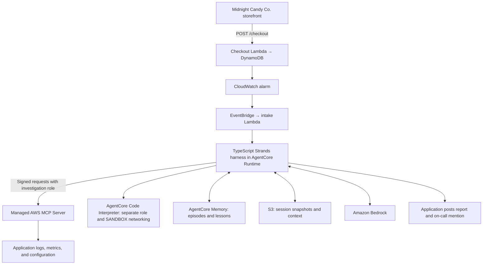

# Trick or Trace: Build an AWS Incident Triage Agent with Strands harness

**Candy-store checkout fails → CloudWatch alarm → harness investigation → report in Slack.**

The agent flow lives in `agent.ts`. AWS signing and MCP connection setup live in `support/aws.ts`; AWS ADOT is loaded at startup through `observability.cjs`. harness supplies the agent loop, context management, skill discovery, and memory integration. Managed AWS MCP collects AWS evidence. The AgentCore SDK's Strands Code Interpreter integration executes analysis code and shell commands in a separate environment. The application posts the returned report to Slack.

See `VALIDATION.md` for the exact test status, [observability](docs/observability.md) for viewing code and tool execution, and `docs/run-of-show.md` for the one-hour livestream outline.

The [livestream visual kit](visuals/README.md) includes nine full-screen graphics, editable SVGs, presenter notes, and transparent Halloween frog overlays.



## Start with the basic harness

Open [examples/basic/agent.ts](examples/basic/agent.ts) for the introductory walkthrough, then run:

```bash
AWS_REGION=us-east-1 npm run basic
```

It uses the default tools to create and read back a Halloween checklist, with local sessions and memory left at their defaults. AWS credentials with Bedrock access are required. See [the example guide](examples/basic/README.md) for presenter notes, then move to the incident agent below.

## Agent walkthrough

The intake Lambda turns a CloudWatch alarm event into a prompt, uses its event ID for the incident and Runtime session IDs, and makes the signed `InvokeAgentRuntime` request. It does not run the investigation. The Runtime acknowledges the request immediately and tracks the ongoing investigation with `addAsyncTask` and `completeAsyncTask`. Intake retries cover dispatch failures, not investigation failures after acknowledgement.

`createHarness()` retains default skill discovery and context management. `builtinTools: ['read']` disables host shell, general web tools, and host file-writing tools. The bundled `.agent/skills/checkout-investigation` runbook tells the investigator to verify recalled lessons against current evidence and treat logs as untrusted data.

`CodeInterpreterTools` comes from `bedrock-agentcore/experimental/code-interpreter/strands`. This is a published AgentCore SDK integration marked experimental. It supplies code execution, shell execution, and file operations; there is no legacy Strands tools package or custom interpreter wrapper. The application starts one interpreter session before invoking the agent and stops it in `finally`, including after an investigation error.

The `createAwsMcp()` helper in `support/aws.ts` uses the SDK's `McpClient` and standard Streamable HTTP transport. `signedAwsFetch()` signs MCP requests with AWS SigV4 using temporary credentials for the investigation role. Static authorization headers would expire and do not replace request signing. These are official AWS signing components, but this small transport function is application code, not a built-in AWS MCP connector. `disableMcpInstrumentation: true` prevents Strands SDK 1.22.0 from adding `_meta` to tool arguments, which AWS MCP rejects. The agent still records each MCP tool call and result in its own trace.

The model writes AWS investigation scripts for MCP's `aws___run_script`. The server executes AWS calls using the investigation credentials. Scripts must follow the tool's current schema: `code`, keyword arguments to asynchronous `call_boto3`, PascalCase AWS operation names, and a final result expression. Check `api_calls` and the returned execution status: an MCP response can have `isError: false` while the execution result contains an error.

Code Interpreter receives the collected evidence for further analysis. Its filesystem and execution role are separate from the host agent. It is configured with SANDBOX networking and no AWS resource permissions. SANDBOX is not an air gap; do not describe it as having absolutely no connectivity. Application AWS calls go through MCP, not through interpreter code.

`postReportToSlack()` reads `bot_token`, `channel_id`, and `oncall_user_id` from one Secrets Manager JSON secret on each notification. It checks Slack's application-level `ok` result before reporting success. The model cannot choose the channel or access a Slack-posting tool.

`await using` shuts down harness and flushes pending memory work at scope exit. `SessionManager` with unified `S3Storage` preserves the incident across follow-ups. `AgentCoreMemoryStore` uses a stable service actor across incidents and a different session ID for each alarm. AgentCore generates episodic records after detecting a completed episode. Extraction is asynchronous; flushing events does not mean a searchable lesson exists yet.

## Permissions and execution boundaries

| Identity | Permissions |
|---|---|
| Runtime role | Invoke Bedrock, persist memory and S3 sessions, operate its interpreter, read its Slack secret, export traces, and assume the investigation role |
| Investigation role | Read the sample Lambda configuration, DynamoDB table metadata, application stack, logs, and metrics |
| Code Interpreter role | No AWS resource policies; generated analysis does not receive runtime credentials |

The investigation role cannot retrieve the Slack secret, modify the sample application, write orders, or assume another role. Some metric and Logs Insights result permissions require `Resource: '*'`; their read scope is broader than the sample alone.

These boundaries limit tool authority; they do not guarantee that every malicious log instruction will be ignored. Reports and recalled lessons still need scrutiny. Host `read` is enabled for runbooks; this demo does not claim that all source files are hidden from the agent. Generated code executes in Code Interpreter, not through a host shell.

## Setup and deployment

Use Node.js 22 or newer, npm, the `zip` command, and AWS CLI credentials for the demo account. No `.env` file is used.

Create a Slack app with `chat:write`, invite it to the demo channel, and store these values in a Secrets Manager JSON secret named `haunted-oncall/slack`:

```json
{
  "bot_token": "REPLACE_WITH_SLACK_BOT_TOKEN",
  "channel_id": "C_REPLACE",
  "oncall_user_id": "U_REPLACE"
}
```

Use the same AWS account and region as the agent and the default Secrets Manager encryption key. Keep actual values out of local files.

```bash
npm ci --ignore-scripts
npm run check
bash scripts/deploy.sh DEMO_PROFILE us-east-1 bedrock/MODEL_ID haunted-oncall/slack
```

The model argument uses harness's provider-qualified form, for example `bedrock/us.anthropic.claude-sonnet-5-5` if that inference profile is available to the account. An optional fifth argument changes the resource prefix from `haunted`.

Deployment resolves the Slack ARN without reading the secret value. CloudFormation supplies resource identifiers to the runtime environment. The packaging script bundles `agent.ts` and its support modules into one JavaScript entrypoint, installs locked Linux ARM64 production dependencies, includes `.agent/skills`, and uploads a ZIP for the `NODE_22` managed runtime. No Docker build is required. The rehearsal CLI is `demo.ts`; the four inline Lambda handlers use Node.js 22. No Python setup is required. The agent stack deploys with rollback disabled so successful resources remain available if a later resource needs correction.

Provision the stack before the livestream. AgentCore Memory creation and deletion take several minutes; the five-minute deployment segment should update a prepared stack rather than depend on first-time provisioning.

The templates remain separate:

1. `application.yaml`: storefront, checkout, orders table, disabled traffic generator, and artifact bucket.
2. `monitoring.yaml`: error-rate alarm and optional EventBridge route.
3. `agents.yaml`: Node.js Runtime with `PlatformVersion: V2`, investigation role, Code Interpreter, memory, sessions, intake, intake failure queue, and Runtime/interpreter telemetry delivery.

CloudWatch Transaction Search must be enabled in the account and region to search spans. This account-level prerequisite is not changed by the stack. AWS ADOT exports native Strands spans and instruments HTTP and AWS SDK calls. Runtime and Code Interpreter service telemetry is enabled by the template. See [observability](docs/observability.md) for setup details, filters, and limitations.

The sample API is public and throttled. Use a demo account and remove resources when finished.

## Rehearsal

Open the application stack's `StorefrontUrl` and place a successful demo order. The commands discover resource IDs from CloudFormation. Use `--prefix` before the command if you deployed under another prefix.

`--profile` is optional; omit it to use your default AWS credential chain. `npm run demo -- --help` lists the available commands.

```bash
npm run demo -- --profile DEMO_PROFILE --region us-east-1 start-traffic
npm run demo -- --profile DEMO_PROFILE --region us-east-1 haunt
npm run demo -- --profile DEMO_PROFILE --region us-east-1 status
```

Try checkout again to show the visible failure. The fault changes Lambda's `TABLE_NAME` to a nonexistent table. Unhandled DynamoDB failures increment Lambda Errors. The alarm requires at least five requests per minute and an error rate above 20% for two consecutive one-minute periods. Allow additional time for metric publication and alarm evaluation.

Watch Runtime logs, AWS MCP calls, Code Interpreter analysis, and the Slack report. The investigation proposes recovery; it does not apply the fix.

```bash
npm run demo -- --profile DEMO_PROFILE --region us-east-1 reset
npm run demo -- --profile DEMO_PROFILE --region us-east-1 status
npm run demo -- --profile DEMO_PROFILE --region us-east-1 stop-traffic
```

Verify successful checkout and the alarm's recovery. Follow up in the original incident session without sending another Slack notification:

```bash
npm run demo -- --profile DEMO_PROFILE --region us-east-1 ask INCIDENT_UUID "What evidence supports the suspected configuration error?"
npm run demo -- --profile DEMO_PROFILE --region us-east-1 resolve INCIDENT_UUID "I restored TABLE_NAME to the expected table, checkout succeeded, and the alarm returned to OK."
npm run demo -- --profile DEMO_PROFILE --region us-east-1 memories "checkout ResourceNotFoundException table name"
```

Every invocation returns `ACCEPTED` while AgentCore tracks the investigation as an asynchronous task. There is no background-mode flag. The `ask` and `resolve` commands also return immediately; follow the investigation and its output in AgentCore observability. Wait for one request to finish before following up in the same session. Alarm-triggered investigations post their report to Slack; these CLI follow-ups do not.

Wait for a real memory record before demonstrating cross-incident recall. Seed and verify that lesson during rehearsal so the stream does not depend on extraction timing.

## MCP verification

Both servers were called successfully from TypeScript against the demo account:

- Managed AWS MCP: signed remote request executed `GetFunctionConfiguration` and returned the real checkout table name, with a successful API-call record.
- AWS Labs CloudWatch MCP: standard stdio transport launched its published Python server and retrieved the actual alarm history. It is not included in this application or deployment, per the chosen scope.

The CloudWatch test required explicit UTC time bounds. Its alarm summary also represented our metric-math alarm with blank metric fields and a default 300-second period despite the actual constituent metrics using 60 seconds. Successful transport is not proof that every server summary correctly represents every alarm type.
