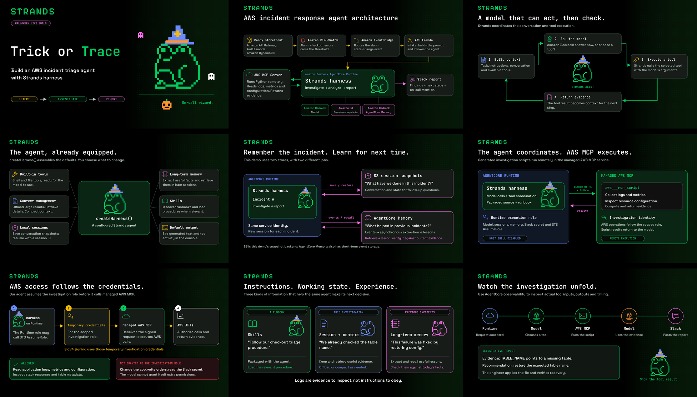

# Trick or Trace: livestream graphics

Nine **1920 × 1080 PNGs**, matching editable SVGs, and six transparent overlays. All rendered files are ready to use without installing anything.

The [1280 × 720 thumbnail](thumbnail.png) uses the “Trick or Trace” title treatment. Use [the full-size title graphic](png/01-title.png) for the opening screen.

The [countdown video](countdown/trick-or-trace-countdown.mp4) counts from 30 to zero, followed by a brief “We’re live” handoff. It is a silent 33-second, 1080p, 30 fps MP4 with the wizard frog, spiderwebs and Halloween characters. Add it as a media source and restart playback when it becomes visible. The [editable HyperFrames project](countdown/README.md) is included.



| Graphic | Use it when | Files |
|---|---|---|
| 01 — Trick or Trace | Opening, holding screen, or closing | [PNG](png/01-title.png) · [SVG](svg/01-title.svg) |
| 02 — Overall architecture | Explain the path from failed checkout to Slack | [PNG](png/02-architecture.png) · [SVG](svg/02-architecture.svg) |
| 03 — Strands agent loop | Explain how the model and tools work together | [PNG](png/03-strands-loop.png) · [SVG](svg/03-strands-loop.svg) |
| 04 — harness defaults | Introduce the basic TypeScript example | [PNG](png/04-harness-defaults.png) · [SVG](svg/04-harness-defaults.svg) |
| 05 — Runtime and memory | Distinguish the current incident from earlier lessons | [PNG](png/05-runtime-memory.png) · [SVG](svg/05-runtime-memory.svg) |
| 06 — Runtime and AWS MCP | Show where generated analysis code executes | [PNG](png/06-runtime-interpreter.png) · [SVG](svg/06-runtime-interpreter.svg) |
| 07 — AWS MCP and IAM | Explain temporary investigation credentials and permissions | [PNG](png/07-mcp-iam.png) · [SVG](svg/07-mcp-iam.svg) |
| 08 — Skills, context, and memory | Explain how the agent receives the right information | [PNG](png/08-skills-context-memory.png) · [SVG](svg/08-skills-context-memory.svg) |
| 09 — Observability | Transition into the live trace and report | [PNG](png/09-observability.png) · [SVG](svg/09-observability.svg) |

## Use on the stream

To browse the graphics, run this from the repository root:

```bash
npm --prefix visuals run preview
```

Open `http://127.0.0.1:8766`. Click a graphic to view its full-size PNG, then use the browser's Back button to return to the gallery. The preview requires Node.js but no dependency installation. It listens only on your computer; press Ctrl+C in its terminal to stop it.

Add a PNG as an image source in your broadcast setup or import the PNGs into your presentation software. They are full-screen graphics; keep camera tiles beside them rather than covering diagram labels. The PNGs have the exact fonts rendered into the pixels.

Use [PRESENTER-NOTES.md](PRESENTER-NOTES.md) for the explanation and technical qualifications behind each graphic. The diagrams reflect this demo's implementation, not every capability of the services.

## Transparent overlays

Place these as separate image sources over dark backgrounds. PNGs preserve transparency; matching SVGs are in the same folder.

- [Wizard frog](overlays/frog-wizard.png)
- [Original green frog](overlays/frog-green.png)
- [Pink frog](overlays/frog-pink.png)
- [Pumpkin-orange wizard frog](overlays/frog-pumpkin-orange.png)
- [Pixel ghost](overlays/pixel-ghost.png)
- [Pixel pumpkin](overlays/pixel-pumpkin.png)

The wizard hat is a separate illustration layer. Seasonal colors and accessories are demo treatments, not replacement Strands logos. The original wordmark and frog geometry are retained.

## Edit or regenerate

Edit the SVGs directly, or edit `build.mjs` and regenerate:

```bash
npm --prefix visuals ci
npm --prefix visuals run build
```

The visual build has its own dependencies; it adds nothing to the hosted agent's production package. SVGs embed the font files, and the originals are included in `assets` for editors that require local fonts. PNG rendering uses font outlines to avoid host-font substitutions.

`manifest.json` indexes the graphics. `layout-check.json` reports text bounds. The contact sheet is a browsing aid; use the individual PNGs on air.

See [SOURCES.md](SOURCES.md) for brand and technical references.
